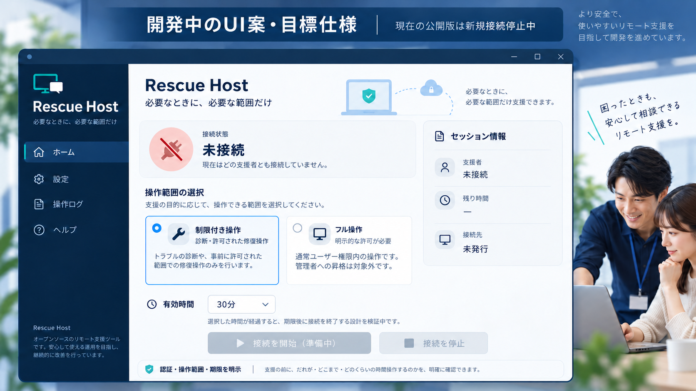

# Rescue Host

**開発中・新規接続停止・本番利用不可（v0.2.1-dev）**

## 一言の価値

Windows PCの診断と修復を、許可した操作範囲と期限のもとで遠隔から支援することを目指すプロジェクトです。
現在は設定とオフライン制御モデルの開発段階で、遠隔支援そのものは利用できません。

## GUIの開発イメージ

この画像は**AI生成の目標UI案であり、現在のアプリのスクリーンショットではありません**。
現在の公開版では新規接続を無効化しており、遠隔支援は利用できません。
画像内の操作ログ・ヘルプ・セッション情報などの配置や機能は検討用で、実装済み・提供予定を保証するものではありません。
「フル操作」は許可された通常ユーザー権限内の操作を意図しており、管理者昇格は含みません。
実際の提供状況は下記の主要機能と[提供段階の詳細](docs/status.md)を参照してください。

## 想定ユースケース

以下は開発目標であり、提供済みの遠隔機能ではありません。

- Windows PCのシステム情報やネットワーク状態を遠隔で診断する。
- 許可された範囲で、承認済みサービスの再起動などの修復を支援する。
- 必要に応じて通常ユーザーのフル操作を選ぶ。
  管理者昇格は含まない。

## 目標利用フロー

救援されるPC（host）で公開鍵、操作範囲、利用時間を設定 → 安全要件を満たす接続 → 操作するPC（controller）から診断や修復 → 停止または期限による失効、終了確認。
これは目標の流れで、現在は接続開始を拒否します。
既存Uptermの転送先限定と同一ユーザー監視による確実な失効が不足しているため、GUIとワーカーの両方に解除スイッチのない開始ゲートがあります。

## 主要機能

提供段階と検証状況は別の属性です。
**Alpha**は本番利用不可の一部実装、**計画**は未提供、**部分検証済み**はモックなど限定範囲の公開証拠を示します。
BetaとGAを含む[定義と詳細表](docs/status.md)を参照してください。

| 機能 | 提供段階 | 検証状況 |
|---|---|---|
| GUIの制限付き／フル操作の選択と保存（設定のみ） | Alpha | 部分検証済み |
| 操作方針、固定宛先、期限と失効のオフラインモデル | Alpha | 部分検証済み |
| 旧セッションの確認と停止要求の補助 | Alpha | 部分検証済み |
| 実接続での遠隔診断と修復、フル操作 | 計画 | 未検証 |
| 実SSHの転送先制約、保護されたWindows監督と強制失効 | 計画 | 未検証 |

GUIの操作モード選択は実権限制御や管理者昇格の認可ではありません。
旧セッションは停止要求後も終了未確認の記録を保持し、**画面を閉じても接続停止を保証しません**。
[回復時の注意](docs/recovery.md)を確認してください。

## 対応環境

実リモート接続を対応済みと呼べるOSはありません。

| 役割 | 想定と現在の範囲 |
|---|---|
| host（救援されるPC） | Windowsを主対象として計画。実Windows未検証、新規接続は無効。macOSとLinuxのhostは未対応 |
| controller（操作するPC） | macOSを想定。WindowsとLinuxを含め、実接続は未検証 |
| 開発と試験 | Python 3.11以上を想定。公開済みの検証はLinux上のオフライン処理のみ。GUI実表示と配布EXEは未検証 |

[OS、CPU、GUI、配布物ごとの詳細](docs/status.md#osと役割ごとの範囲)を参照してください。

## 詳細へのリンク

- [構成と実装境界](docs/architecture.md)（既存のSVG／PNG構成図）
- [安全要件と接続停止の理由](docs/security.md)
- [提供段階、対応環境、公開済み検証結果](docs/status.md)
- [開発とオフライン検証](docs/development.md)
- [リポジトリの配置方針](docs/repository-layout.md)
- [旧セッションの回復と画面終了](docs/recovery.md)
- [変更履歴](CHANGELOG.md) / [ライセンス](LICENSE)
