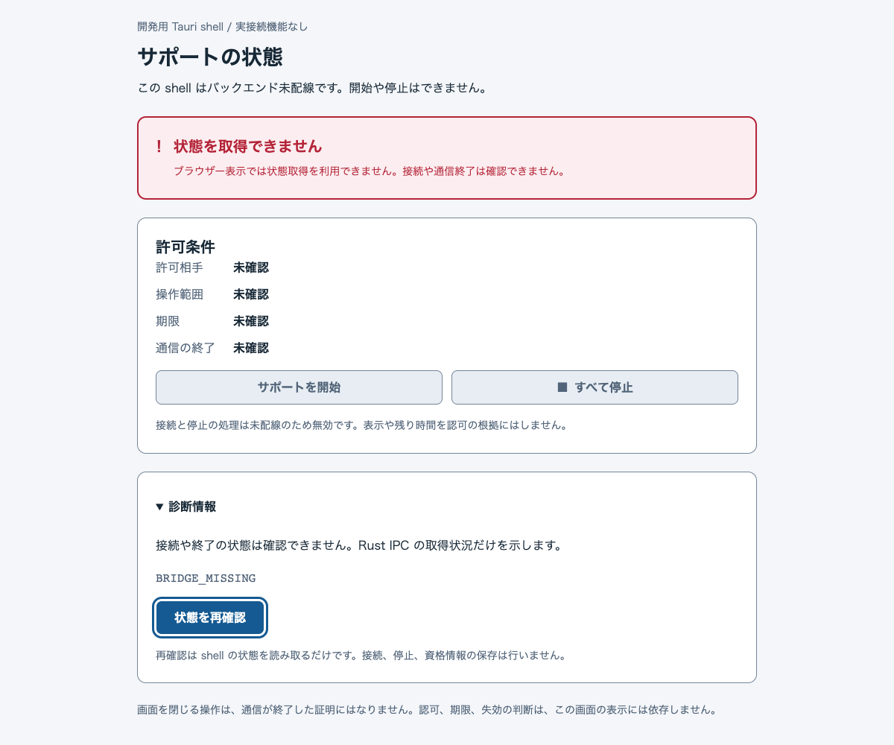
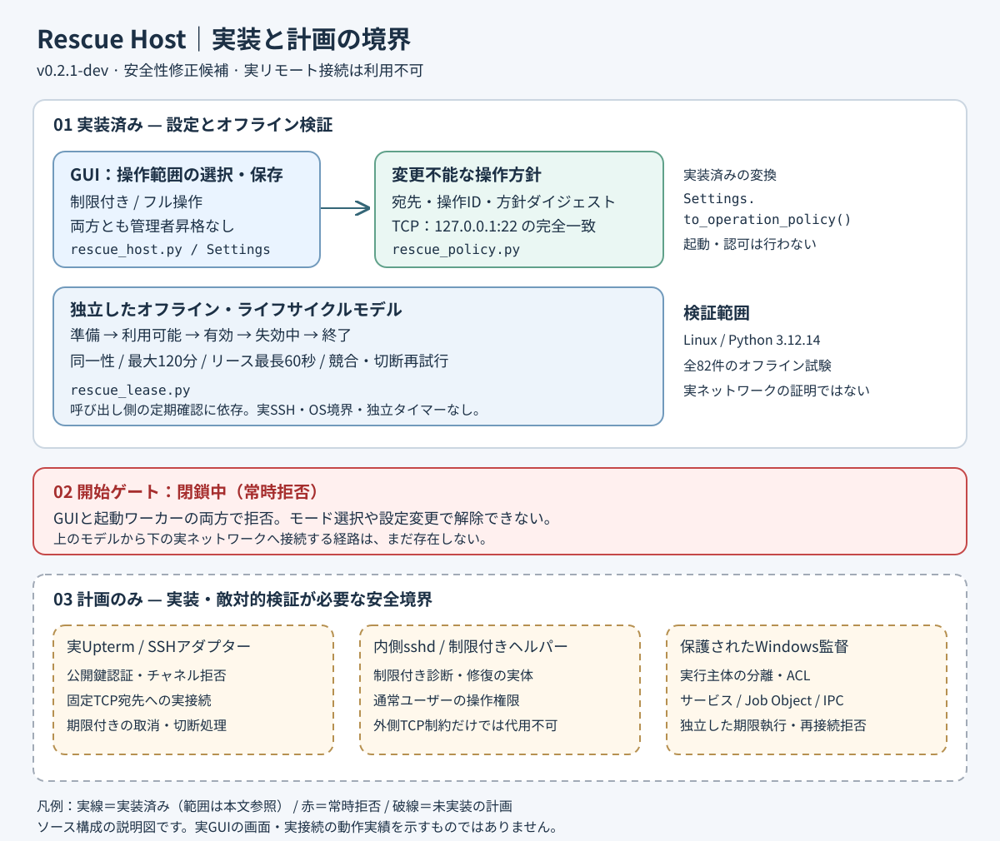

# Rescue Host

**開発中。新規接続は停止中で、本番利用できません。**

顧客や社員が自分のPCへの接続主導権を持ち、許可した相手に一時的なアクセスを渡して、エージェントによる環境構築や作業代行を受けられることを目指すプロジェクトです。
相手、操作範囲、期限をPC側で承認し、停止や期限でアクセスを失効させる構想です。
現在のTauri配布物は**バックエンド未接続のGUI評価版**で、Go / SSHはUIと未配線、開始と停止は無効です。

## 想定する用途と利用の流れ

以下は開発目標であり、現在利用できる遠隔機能ではありません。

- 開発ツールの導入や設定など、環境構築を一時的に任せる。
- PCの診断や修復、日常の作業を許可した範囲で代行してもらう。
- 必要な間だけアクセスを渡し、作業後は許可を終了する。

目標の流れは、PC側（host）で相手、操作範囲、期限を承認 → 操作側（operator）へ一時アクセスを渡す → 許可範囲で作業 → 停止または期限による失効と終了確認です。
初期評価は非管理者の遠隔ゲストを対象とし、管理者昇格は含みません。
PCや監督サービスの再起動後は許可をすべて失効させ、再承認を求める方針です。
この流れを成立させる保護サービス、認証付きIPC、実SSHの製品配線は未検証です。

## GUIの現在地

画像は実HTML/CSSのブラウザー描画で、接続機能を持たないshellの表示例です。
[AI生成の目標UI案](docs/assets/rescue-host-ui-concept.png)も保管していますが、実画面や実装済み機能を示しません。

## 主な機能と状態

| 対象 | 現在の状態 |
| --- | --- |
| Tauri GUI | 未接続状態の表示、診断表示、状態の再確認を実装。開始と停止は無効 |
| 既存Python版 | 操作範囲の設定保存、期限と失効のオフラインモデル、旧記録の回復補助を実装 |
| Go基盤 | 認証、固定宛先、期限と失効、所有接続の管理、未配線の制御入口と認可モデルをmainへ統合済み |
| 製品用の制御配線 | codec、coordinator、service host等の未接続準備コードを[#72](https://github.com/O2-CONNECTIVE/rescue-host/pull/72)でmainへ統合済み。UIからの製品接続は利用不可 |
| 制御経路の準備 | Windows側clientとbootstrap周辺の準備を進めています。実pipeの認証、正規承認、実SSHとの接続は未検証です |
| 遠隔作業とOS保護 | 実サービス、ACL、製品のJob管理、認証付きIPC、実SSHの一連の製品動作は未検証 |

GUI評価版の実機起動と表示は利用者から確認済みです。
固定guest設定の保護Root読取と要求単位の検査leaseは[#147](https://github.com/O2-CONNECTIVE/rescue-host/pull/147)、確認から同issuerの単回発行・status・revokeまでのsource/fake経路は[#148](https://github.com/O2-CONNECTIVE/rescue-host/pull/148)で統合しました。
同Endpointの検査leaseを入力分離前に保持するAPIは[#149](https://github.com/O2-CONNECTIVE/rescue-host/pull/149)で統合しました。
main `d4cb12009cdd80786b26ca18c666a84e6b1f3f3e` のGo・Python・日本語検査は全7ジョブ成功しています。
発行経路の正例はprivate OS seamを置換したfixtureで、製品runtime providerは未登録、実LaunchとSSHは未接続です。
未起動guestの準備は、明示入口から元ownerと実stager factoryへのsource配線を追加しました。正規認証policy producerは未構成で、実Windowsの製品入口は拒否を維持します。
承認主体は[方式B](docs/adr/0002-operator-sid-policy.md)を採用しました。指定Windowsユーザーの再ログイン後も新規承認資格はありますが、既存許可や接続を引き継ぎません。
認証coreは固定SIDと実message主体を分離し、専用helper資源の未構成拒否を維持します。保護Root・Service側への供給接続は後続です。
このCIは実機SSH、停止の強制力、OS保護、製品接続の成功や保証ではありません。
旧mainの配布CIの終了確認失敗は履歴として保持し、#72で更新した終了観測契約と分けて扱います。
過去の統合版で通常nativeと展開EXEの限定した終了確認が成功しました。各版のCI結果は固定したsourceごとに確認します。
[確認した版、公開証跡、統合済み準備コード、残る制約](docs/status.md)を参照してください。

## OSごとの対象

実リモート接続を製品として対応済みと呼べるOSはありません。

| 役割 | Windows | macOS | Linux |
| --- | --- | --- | --- |
| host（アクセスを渡すPC） | 初期対象として開発中 | 未対応 | 未対応 |
| operator（操作側） | 構想段階 | 構想段階 | 構想段階 |
| Tauri GUI評価版 | x64の未接続評価版 | native評価未確認 | native評価未確認 |
| 開発検証 | Python / Goの限定CI | Python / Goの限定CI | Python / Goの限定CI |

3 OSでのGo試験成功は、製品のOS対応や保護境界の成立を証明しません。
サポート終了OSを用いた確認は互換性評価として分け、正式対応や本番安全性の証拠にしません。
OS版やCPUごとの確認範囲は[対応環境と検証状況](docs/status.md#osと役割ごとの範囲)で確認します。

## 評価と開発の入口

GUI評価は[未接続Tauri評価版の説明](docs/tauri-evaluation.md)と[同梱手順](docs/tauri-evaluation-readme.txt)に沿い、表示や操作性と通信の検証を分けて記録します。
候補のsource SHA、ハッシュ、CI結果を照合し、開始と停止が無効であることを確認します。
新しい候補の合格や配布可を、過去の実機確認から推定しません。
実機の事前確認、未確定項目、実行時承認、受け入れと撤去の準備は[Windows限定評価手順](docs/windows-evaluation-runbook.md)にまとめています。

開発時は[Pythonのオフライン検証](docs/development.md)、[Tauriの検証手順](ui/tauri/README.md)、[Goの検証手順](docs/go-ci.md)から対象を選びます。
GUIの終了は通信終了の証明ではありません。
旧Python版の記録を扱う場合は[回復時の注意](docs/recovery.md)を確認してください。

## 構成と詳細資料

現行の設計と安全契約は `docs/`、旧レビュー・引き継ぎ・検証記録は `docs/history/` にあります。

既存の構成図はPython部分の説明です。
現在のGo基盤は[backendの説明](backend/README.md)、製品配線の候補は[制御契約ADR](docs/adr/0001-control-contract-candidate.md)を参照してください。

- [構成図の説明とPNG](docs/architecture.md) / [配置方針](docs/repository-layout.md)
- [安全要件](docs/security.md) / [脅威モデル](docs/threat-model.md) / [検証状況](docs/status.md)
- [UIとアクセシビリティ](docs/design-accessibility.md) / [native検証](docs/tauri-native-smoke.md)
- [開発手順](docs/agent-workflow.md) / [進捗Issue](https://github.com/O2-CONNECTIVE/rescue-host/issues/1)
- [変更履歴](CHANGELOG.md) / [ライセンス](LICENSE)
