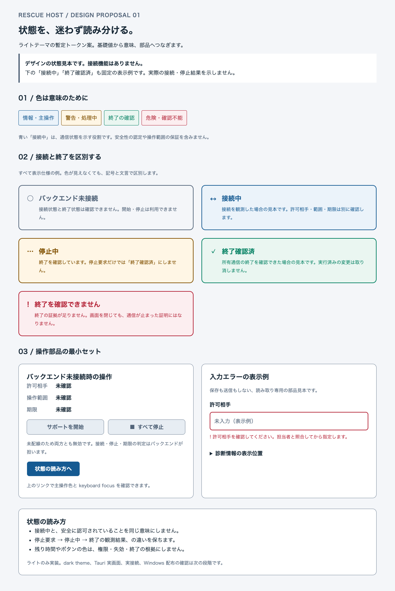

# Tauri デザイントークン案の確認範囲

[設計仕様](tauri-design-tokens.md) / [Issue #16](https://github.com/O2-CONNECTIVE/rescue-host/issues/16)

対象は同じ PR のライトテーマ tokens と静的 HTML/CSS 状態見本です。
2026-10-27、macOS の Chrome 156.0.8078.48 で実際に描画し、広幅・狭幅・forced colors の画像を目視確認しました。
Tauri runtime と Go バックエンドは含まれず、実接続や終了の検証ではありません。

## コントラスト

`python3 ui/tauri/design/check_tokens.py` で 120 tokens の参照と 23 組のコントラストを確認しました。
WCAG の相対輝度計算を用い、黒 / 白の 21:1 と同色の 1:1 を測定器側の既知値にしています。
初案の境界色 `#8091A3` は subtle 背景で 2.74:1 だったため、`#748598` へ調整しました。
これは静的検証の修正記録であり、振る舞い TDD の赤 → 緑の実績ではありません。

| 組合せ | 最低実測値 | 目標 | 結果 |
| --- | ---: | ---: | --- |
| 本文 / 3 種の surface | 12.78:1 | 4.5:1 | 達成 |
| 補助文字 / 3 種の surface | 5.15:1 | 4.5:1 | 達成 |
| 状態文字 / 対応 surface | 4.51:1 | 4.5:1 | 達成 |
| 主操作・危険操作の文字 / 通常・hover 背景 | 6.49:1 | 4.5:1 | 達成 |
| 無効 button の文字 / 背景 | 5.15:1 | 4.5:1 | 達成 |
| 境界 / 3 種の surface、無効 button の境界 / 背景 | 3.21:1 | 3:1 | 達成 |
| focus ring / 3 種の surface | 6.12:1 | 3:1 | 達成 |

## ブラウザーで確認したこと

| 確認 | 結果と限界 |
| --- | --- |
| 1200 CSS px / 360 CSS px | 横の欠落・領域のはみ出しなし。広幅は 2 列、狭幅は 1 列 |
| 200% 相当 | 600 CSS px・device scale factor 2 で描画。実 OS の DPI 変更ではない |
| 文字 200% | 1200px 幅で root font-size を 200% に変更しても横の欠落なし |
| keyboard / focus | Tab / Shift+Tab、リンクの Enter、診断の開閉を確認。focus は 3px の青い輪郭 |
| エラー | 入力に `aria-invalid` と `aria-describedby` あり。文言と ! 記号を表示 |
| 開始・停止 | 両方とも disabled。未配線の理由を表示。停止や接続処理は実行されない |
| reduced motion | ブラウザー模擬で transition 0s |
| forced colors | ブラウザー模擬で輪郭・記号・文言を保持。実 OS の設定での確認は未実施 |
| OS dark 指定 | ライトテーマのまま表示。ダークテーマ実装とは扱わない |
| 実行エラー | ページ例外なし。script は含まない |

## 回帰と未確認

既存 `src/`、`tests/`、ビルドスクリプト、Python CI は変更していません。
Python 3.13.2 で構文検証と既存の `test_backend_policy_lease.py` 19 件は成功しました。
全体の unittest 探索は 34 件まで実行し、GUI 関連 3 モジュールの import が `_tkinter` 不在で失敗しました。
全体回帰成功とは扱いません。
PR の Python CI と、このブラウザー表示検証の範囲は別です。

ui-ux-design スキル本文は参照済みです。
指定された `core/design-doctrine.md`、`core/perception.md`、`core/judgment.md` は正規 skill resource の取得が失敗し、未参照です。
スキル本文と依頼要件で独立作業を進めた制約として残します。

Tauri native build / 起動、Windows / Linux の WebView、実 DPI、高コントラストの実 OS 設定、スクリーンリーダー、Go sidecar の起動・親死・中断・停止、配布 EXE は未検証です。
Rust toolchain や WebView2 のインストール、システム設定変更はしていません。
これらは次段階の受入とし、既存の製品接続ゲートを維持します。
